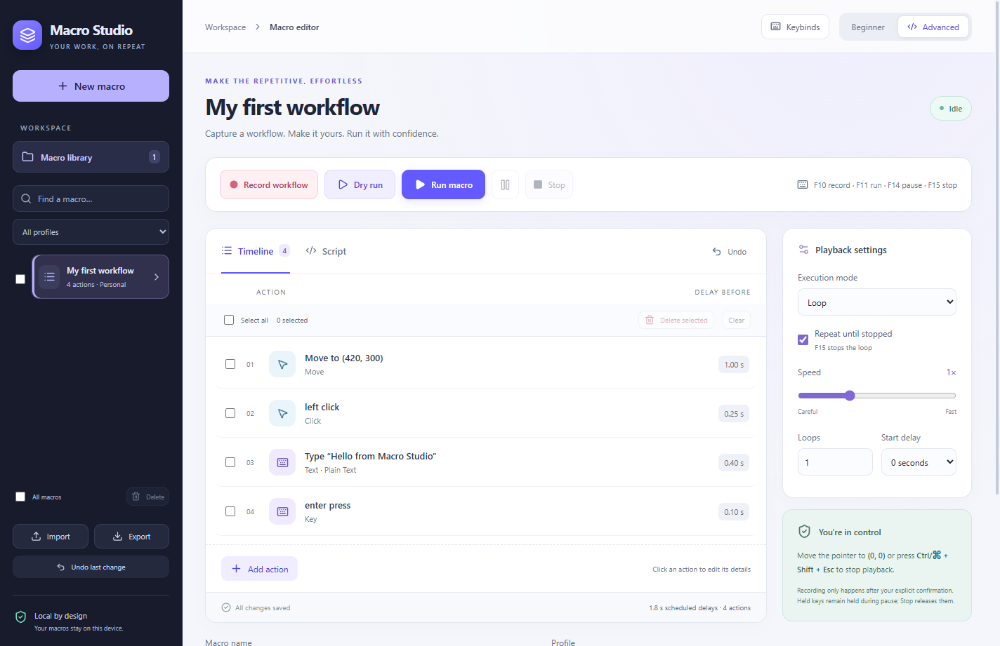

# Macro Studio

**Record a workflow. Edit the steps. Run it your way.**

A local desktop app for keyboard and mouse automation, with a visual editor for beginners and a bounded scripting language for advanced users. Built with Electron, React/TypeScript and an isolated Python automation engine.

[Download Windows](https://github.com/hitech966/macro-studio/releases/latest) · [Report a bug](https://github.com/hitech966/macro-studio/issues) · [MIT license](LICENSE) · [Verification notes](VERIFICATION.md)



> **Early MVP, version 0.2.3.** Windows x64 is the tested distribution. macOS and Linux X11 have implementation paths but have not been tested on their target systems. Wayland is unsupported. Recent UI checks passed; the latest full native suite failed global F8 delivery, so global shortcuts should be checked on your system before relying on them.

## Download and start

1. Open [Releases](https://github.com/hitech966/macro-studio/releases/latest) and download **Macro-Studio-Windows-x64.zip**.
2. Extract the entire ZIP to a folder you own. Keep the executable and all companion files together.
3. Open **Macro Studio.exe**. This portable build includes its automation engine; you do not need Python or Node.js.
4. Start with **Dry run**, then use **Run macro** when your target window is ready.

The Windows build is unsigned. There is no installer or automatic update system yet. To update, close the app and extract the newer release into a separate folder; the macro library is stored in your user application-data directory.

## What you can do

| Area | Capabilities |
| --- | --- |
| Recording | Explicit mouse movement, left/right/middle buttons, dragging, wheel and keyboard capture. Start countdown and pause/resume. |
| Visual editor | Edit coordinates, keys, text and delays; add, duplicate, reorder or delete steps. Paginated timelines for larger recordings. |
| Multiple selection | Select actions or macros, delete selected items together, and undo the change. Select all includes all timeline pages. |
| Playback | Separate adjacent **Dry run** and **Run macro** buttons; speed from 0.1x to 10x; configurable delays and countdown. |
| Repetition | Run once, repeat 1-1,000 times, or loop until stopped. Pause and stop work during loops. |
| Shortcuts | Change Record, Run, Pause and Stop keybinds. Settings persist, and duplicate/unavailable combinations are rejected. |
| Library | Named profiles, search, JSON import/export, validation and local autosave. |
| Advanced mode | Script editor, bounded repeat blocks and cursor-position conditions; compile scripts into editable timeline actions. |
| Recovery | Recording journal, recovery as a separate macro, atomic saves and a previous-file backup. |
| Diagnostics | Activity logs and visible permission, validation and engine errors. Logs do not include recorded keystrokes or typed text. |

Mouse movement uses hook events plus position sampling approximately every 20 ms while recording is active. Very fast motion is sampled rather than storing every hardware event; the latest coalesced point is retained before pause, finish or other actions. Click and wheel positions are also retained. Unsupported special/media keys are ignored.

## Your first macro

1. Choose **New macro**, give it a name and assign a profile.
2. Set **Start delay** so you have time to switch to your target app.
3. Click **Record workflow** and confirm recording. Only then is input capture enabled.
4. Perform the workflow. Use the configured Record or Stop key to finish (F6/F9 by default).
5. Review the timeline, adjust steps/delays and remove unwanted actions. Recording replaces the selected macro's timeline; session Undo can restore its previous version.
6. Click **Dry run** to check validation, timing and repetition without sending input.
7. Choose **Run once** or **Loop** in Playback settings. For continuous execution, select **Repeat until stopped**.
8. Click **Run macro**, switch to your target during the countdown, and use Stop when needed.

**Dry run is a timing/validation simulation:** it cannot confirm that your target app accepts input. Playback uses absolute screen coordinates and the active desktop; changing focus, screen scaling or window positions can change the outcome.

## Keybinds and stopping

Open **Keybinds** at the top right, click a field, press a function key or a key with modifiers, then save. Reset defaults fills the fields; save to apply. Normal shortcuts are suspended while editing bindings. The emergency shortcut stays reserved.

| Default | Action |
| --- | --- |
| F6 | Open recording confirmation / finish active recording |
| F7 | Run selected macro with native input and current playback settings |
| F8 | Pause/resume playback or recording |
| F9 | Stop recording/playback, including countdown |
| Ctrl/Command + Shift + Escape | Emergency stop |
| Pointer within 2 pixels of physical (0, 0) | Emergency stop during native playback |

Assigned single function-key shortcuts are omitted from recordings. Global shortcuts may conflict with other apps; close duplicate instances and check the input setup panel. On Windows the emergency combination can also open Task Manager. **Stop releases tracked held keys/buttons; Pause preserves held input during playback**, so use Stop to end a drag or key chord.

## Platforms and permissions

| Platform | Status | Requirements |
| --- | --- | --- |
| Windows x64 | Portable release; exercised locally | Interactive desktop. Elevated apps/protected desktops may reject input. |
| macOS | Implementation present, untested | Accessibility and Input Monitoring permissions; build on macOS. Signing/notarization not provided. |
| Linux X11 | Implementation present, untested | Interactive X11 session with DISPLAY and pynput dependencies. |
| Linux Wayland | Unsupported | Native input is disabled; an X11 session is required. |

The input setup panel surfaces adapter/permission errors. Adapter availability does not guarantee delivery to every application. See [pynput platform limitations](https://pynput.readthedocs.io/en/latest/limitations.html).

## Privacy and safety

Recording is explicit and user initiated. There is no cloud sync, telemetry, credential API, stealth recording, privilege bypass or anti-cheat evasion. Position sampling runs only during active recording. Native playback uses a listener for the pointer fail-safe.

**Macros, journals, exports and backups contain recorded input in plain text.** The app cannot identify password fields automatically. Avoid sensitive input and review exports before sharing them. The app does not synchronize playback to a particular target window.

## Develop from source

Use **Node.js 24**, **Python 3.12** and Git (the versions exercised locally). Clone the repository, then install from the lockfile:

```sh
git clone https://github.com/hitech966/macro-studio.git
cd macro-studio
npm ci
npx install-electron --no
```

Windows:

```powershell
python -m venv .venv
.\.venv\Scripts\python.exe -m pip install -r engine/requirements.txt
npm start
```

macOS / Linux X11 (target-platform validation still required):

```sh
python3 -m venv .venv
.venv/bin/python -m pip install -r engine/requirements.txt
npm start
```

The launcher looks for the local virtual environment first. Set `MACRO_PYTHON` to an absolute interpreter path to override it. Missing runtime/input dependencies are surfaced by the desktop app.

For live UI development, run `npm run dev` and `npm run desktop:dev` in separate terminals. A browser at `http://127.0.0.1:5173` is an editor preview with browser-local storage; native input and global shortcuts require the desktop app.

## Tests and packaging

```sh
npm test              # Engine + shortcut unit tests; no real input
npm run build         # TypeScript check + production UI
npx electron . --smoke-test --smoke-ui  # Desktop UI/IPC checks
npm run test:desktop  # Full suite, including real native input
```

Native tests open/focus a disposable target, record explicit test input and inject bounded test actions. Leave the keyboard/mouse free while they run and close other app instances to avoid shortcut conflicts. They reset an isolated test profile under `test-results/`, not your normal library. The UI suite explicitly marks native checks as skipped. See [VERIFICATION.md](VERIFICATION.md) for results and the unresolved global F8 issue. CI tests/builds on Windows, macOS and Linux do **not** establish native input compatibility.

Package a portable desktop folder with its own Python runtime:

```powershell
# Windows
.\.venv\Scripts\python.exe -m pip install -r engine/build-requirements.txt
npm run package
```

```sh
# macOS / Linux X11
.venv/bin/python -m pip install -r engine/build-requirements.txt
npm run package
```

Build separately on each target OS/architecture. Windows output: `release/win-unpacked`. The build includes the PyInstaller-frozen engine under `resources/macro-engine`. Signing, notarization, installers and automatic updates remain future work.

## Advanced automation language

This is a deliberately limited automation language, not arbitrary Python/JavaScript execution. It has no filesystem, process, shell, network or credential APIs. **Compile to timeline** validates and replaces the timeline; Run always executes that timeline. Editing the script alone does not change playback.

```text
# Times are seconds. Coordinates are absolute screen pixels.
wait 1
move 420 300
click left
type "Hello from Macro Studio"
key enter

repeat 3
  wait 0.4
  scroll 0 -1
end

# Execute the block only if the pointer is within 8 pixels of this point.
if_cursor 420 300 8
  key_down ctrl
  key a
  key_up ctrl
end
```

Commands: `move x y`, `click left|right|middle`, `button_down button`, `button_up button`, `scroll dx dy`, `type "JSON string"`, `key name`, `key_down name`, `key_up name`, `wait seconds`, `repeat count ... end`, `if_cursor x y tolerance ... end`. Keys may be single characters or supported names such as `enter`, `tab`, `esc`, `ctrl`, `shift`, `cmd`, `home`, arrows and `f1`–`f20`. Key names are lowercase. Integer wheel steps are injected by the native adapter.

JSON macros use `version: 1`, `name`, `profile`, `actions`, plus UI `id`/`script`. Every action has a `type` and a `delay` in milliseconds **before** that action. Unknown action types, nonfinite numbers, excessive nesting and oversized inputs are rejected before native execution. An example is in `examples/safe-demo.json`.

## Reliability and recovery

The scheduler uses a monotonic clock and cumulative deadlines, so processing overhead does not get added to every recorded delay. Pause time is removed from the playback clock. Action order is deterministic for a given input and cursor condition; the target application's response, OS scheduling, keyboard layout, screen scaling and focus are external factors. This is not a hard real-time system and contains no target-window detection or image recognition. Cursor conditions in dry runs use the virtual dry-run cursor, initially `(100,100)`.

Playback waits wake at most every 20 ms or immediately on cancellation. Text input checks cancellation between characters. Native playback monitors the emergency pointer corner even during delays. Stop releases every key/button tracked by the engine. Playback pause retains held input to preserve drag/chord semantics; use Stop to release it. Recording pause stores balancing releases, omits paused input and starts a fresh timing segment on resume. Stop also balances a normal recording's tracked downs.

The engine stops if the parent's heartbeat is absent for about four seconds or its input pipe closes. The UI requests stop when it becomes unresponsive, and saves pending editor changes before normal close. A forcibly killed native worker cannot run its cleanup; no application can guarantee cleanup after an OS/process failure.

Edited macros autosave after about 700 ms of inactivity. Active recordings are journaled about every 250 ms. A crash can lose that last interval. On the next launch, a nonempty recording journal becomes a separate **(recovered)** macro. Never automatically replay it. Saves use a flushed temporary file followed by replacement and a previous-file backup; valid backups are read if the primary JSON is corrupt. Recovery data and backups also contain macro input in plain text.

Libraries live in Electron's per-user application-data directory, normally `%APPDATA%/macro-studio` on Windows, `~/Library/Application Support/macro-studio` on macOS and `$XDG_CONFIG_HOME/macro-studio` or `~/.config/macro-studio` on Linux. No cloud service is used. Default limits are 200 macros, 20,000 actions per macro, 8 nesting levels, 1,000 loops and an 8 MB library/import limit. Undo retains up to 30 snapshots during the current session; it is not persistent history.

## Project structure

```text
src/                 React/TypeScript editor and visual styles
desktop/             Electron lifecycle, preload bridge, shortcuts and storage
engine/core.py       Validation, bounded script compiler and scheduler
engine/backend.py    Native and dry-run input adapters
engine/service.py    Isolated JSON-lines worker and explicit recorder
tests/               Engine and shortcut tests
scripts/             Test runner and engine bundler
examples/            Example JSON macro
docs/                Interface screenshot
.github/workflows/   Automated unit tests and UI build
```

The renderer has context isolation, sandboxing, no Node integration, blocked external navigation and a narrow main-frame IPC bridge. Imported macros are validated and never evaluated as arbitrary code.

## Contributing

Bug reports and pull requests are welcome. See [CONTRIBUTING.md](CONTRIBUTING.md). For input/permission bugs, include your OS, display scaling, keyboard layout, app version and reproduction steps, and say whether Dry run or native playback failed. Do not attach private recordings or passwords.

## License

[MIT](LICENSE). Bundled dependencies retain their respective licenses.
